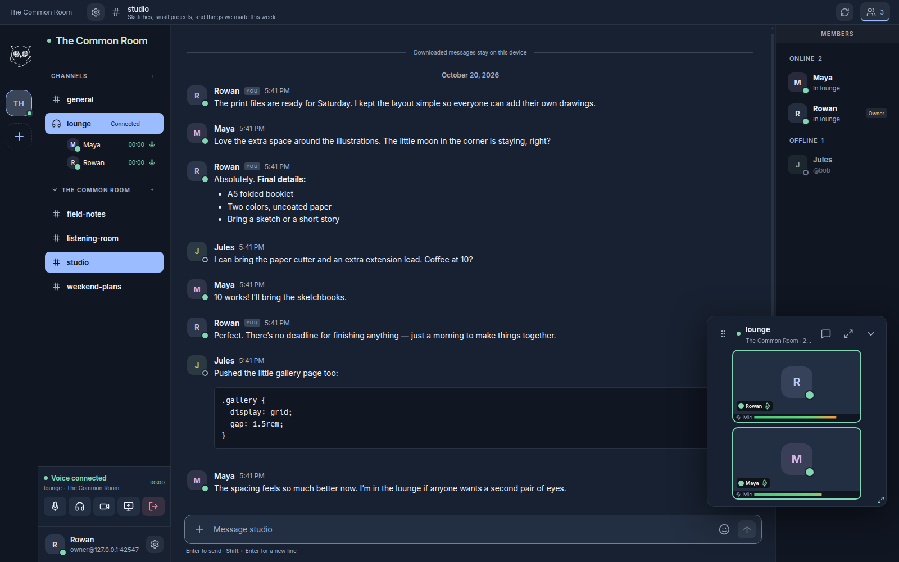

# Haunt Client

This repository contains Haunt's browser client, Electron desktop application,
and reusable TypeScript messaging library. The client connects to independently
hosted Haunt servers; each account belongs to one server and is identified as
`username@server-address`.

The client implements text and direct messaging, calls, notifications, profiles,
moderation interfaces, encrypted client data, and multi-server navigation. It is
under active development and does not implement every Discord feature.



## Features

- Multiple independently authenticated servers.
- Text channels, direct messages, profiles, and notifications.
- Client-side encrypted DMs, images, and client backups.
- [Voice and video calls](docs/calls.md), screen sharing, and audio controls.
- Themes, audio plugins, and optional text to speech.
- Native desktop integrations and signed application updates.

Server accounts, moderation and storage limits are governed by the server you join.
This client does not federate accounts or messages between independent services.

## Platforms

| Target | Distribution |
| --- | --- |
| Browser | Static web build, separately hosted or embedded in Haunt Server |
| Windows x64 | Electron / NSIS installer |
| Linux x64 and arm64 | Electron / AppImage or Fedora RPM |
| macOS arm64 | Electron / DMG, native capture helpers |

An Android client is not yet shipped; see [Android integration](ANDROID.md).
macOS builds target Apple Silicon.

### macOS installation

The DMG includes **Install Haunt.command** and **Installation.txt**. Run the command
with `bash` in Terminal and review its consent prompt. It creates a persistent
code-signing identity in your user keychain and installs Haunt in `~/Applications`
(or updates an existing `/Applications/Haunt.app`). Later **Update app** actions
reuse that identity, stage and verify the replacement, then relaunch Haunt.
The public download remains unsigned and is not notarized by Apple.

### Fedora installation

Download the `.rpm` from the [desktop releases](https://github.com/example-git/haunt-client/releases/latest).
Choose `linux-x64` for Intel/AMD systems or `linux-arm64` for ARM systems, then install
the downloaded file with `sudo dnf install ./Haunt-VERSION-linux-x64.rpm`, substituting
its filename. Open **Haunt** from the applications menu or run `haunt` in a terminal.
The package installs in `/opt/Haunt`; your profile stays in `~/.config/haunt`
(or `$XDG_CONFIG_HOME/haunt`). Removing the package leaves that profile intact.

## Local development

Requires Node.js 22.12+ and npm.

```sh
git clone https://github.com/example-git/haunt-client.git
cd haunt-client
npm ci
npm run dev
```

Open the local development URL and sign in as `username@serveraddress`, with an
optional port after the address. HTTPS is selected by default; turn it off for a
localhost or private-network HTTP server. Saved sign-ins restore that choice.
Paste an invitation link to create an account using a username and password.
A server must allow the browser client's origin. LAN HTTP is supported for messaging,
but browser capture requires HTTPS or localhost. The Electron client handles supported
LAN connections through its native networking layer.

```sh
npm test
npm run build
```

The production web build is written to `dist/`. The generated API snapshots are
included, so ordinary client builds do not require a server checkout or database.

## Desktop builds and updates

```sh
npm run electron:win
npm run electron:linux
npm run electron:mac
```

Build on a supported host for the target platform. Desktop updates verify release
signatures, preserve user profiles, and support failed-startup rollback. See the
[release guide](docs/releases.md) for packaging, versioning, and update behavior.

Linux desktop builds also require a C compiler, `pkg-config`, and development
packages for PulseAudio, GLib and X11 (`libpulse-dev libglib2.0-dev libx11-dev`
on Debian/Ubuntu). Desktop staging builds the audio and shortcut helpers for
the host architecture.

## Repository layout

- `apps/web/`: shared React interface.
- `apps/desktop/`: Electron launcher, native integrations and networking.
- `packages/core/`: service API, sessions, events and messaging abstractions.
- `packages/browser/`: browser storage, media, encryption and notifications.
- `static/`: build inputs, native helpers and generated service contracts.
- `tests/`: unit tests and redistributable fixtures.

[Haunt Server](https://github.com/example-git/haunt-server) includes this repository
at `client/` as a pinned Git submodule. The server's Go integration fixtures live in
its own repository; `npm run test:integration` expects that parent layout and an
explicitly isolated test database.

## Privacy and recovery

DM content and images support end-to-end encryption between participating clients.
Server channels and relayed media have different trust boundaries; do not assume the
server operator is unable to access them. Servers still handle account and connection
metadata. The implementation has not received an independent security audit.

Client backups contain sensitive saved sessions and encryption recovery material.
Keep the backup and its password secure. Local caches improve resilience but are not
a substitute for a deliberate backup.

See the [sync guide](docs/sync.md) for encrypted synchronization and recovery.

## Documentation

- [Appearance](docs/appearance.md)
- [Notifications and desktop behavior](docs/notifications.md)
- [Text to speech](docs/narrator.md)
- [Audio plugin authoring](docs/audio-plugin-authoring.md)
- [Standalone web hosting](docs/web-hosting.md)
- [Development and release qualification](VERIFICATION.md)
- [Project hub and screenshots](https://github.com/example-git/haunt)

## License and participation

Haunt-owned code in this repository is available under the
[BSD 3-Clause License](LICENSE). Bundled third-party assets retain their own
notices. See [CONTRIBUTING.md](CONTRIBUTING.md) before submitting changes and
[SECURITY.md](SECURITY.md) for private vulnerability reports.
